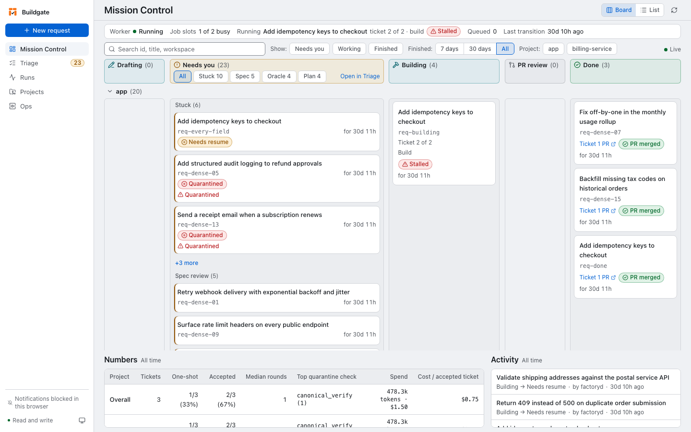

# buildgate

[](https://github.com/ljammula/buildgate/actions/workflows/publish-images.yml)

**Hand your backlog to a coding agent safely: the same code you would get
running the agent yourself, without watching it, and every pull request
arrives with its proof. You keep the merge button.**

Buildgate runs a coding agent (Codex, pi or the Copilot CLI) from a spec you
approve to a pull request. Every build runs in a sandbox, and every stage
advances only on checks the factory ran itself.

## Why

Coding agents can act with your credentials and network and decide for
themselves when work is done. Buildgate constrains execution and advances work
only on factory-owned evidence.

| An agent on its own | Buildgate |
|---|---|
| You watch it run, in your terminal | Requests queue and build unattended; you come back to pull requests and to the decisions that need you |
| Runs on your machine with your network and credentials | Every build runs in a Docker container with **no network interface**, launched by the [OpenShell](https://github.com/NVIDIA/OpenShell) gateway |
| "Done, all tests pass" | Nothing advances on the agent's say-so: each stage is a factory-owned policy decision against durable evidence (test results, diff shape, hashes) |
| Breaks something it was not asked to touch | The repository's full suite (`full_suite_command`) runs in the sandbox before a pull request; a failure gets up to three corrective builds, each told what failed |
| Spends until you notice | Model calls leave only through the sandbox's supervisor, under a per-run policy and buildgate's own spend meter |
| Starts coding from a one-line prompt | You review the spec and the plan (and, opt-in, the acceptance tests) before code is written |

**Measured against the agent alone** (`v0.0.18`): 10 requirements on five
open-source repositories (Go, Java, Python, Ruby, TypeScript), two runs each,
built by buildgate and by bare Codex on the same model (`gpt-6-luna`), then
scored by tests neither had seen.

| | Buildgate | Bare Codex |
|---|---|---|
| Runs passing the unseen tests | 17 of 20 | 19 of 20 |
| Human interventions, spec to pull request | 0 | 0 |
| Fresh tokens per run (uncached input + output), mean | 0.29 M | 0.28 M |
| Minutes per run, mean | 19.8 | 24.3 |

Correctness and cost are level within noise; buildgate is not a better model.
What it adds is that the same work runs unattended, contained, and with its
evidence on the pull request.

## What

Mission Control shows which requests need your attention and the latest
activity:

<picture>
  <source media="(prefers-color-scheme: dark)" srcset="demo/mission-control-dark.png">
  
</picture>

[](https://ljammula.github.io/buildgate/)

[Watch the full 1:55 captioned console tour or explore the interactive walkthrough](https://ljammula.github.io/buildgate/).

## How

You approve the spec and plan. Buildgate then builds and checks each ticket in
a sandbox and prepares a pull request.

```text
   YOU                        BUILDGATE                               YOU
   ---                        ---------                               ---
 "Add X to Y" --> draft spec --> plan tickets --> build in a sealed --> draft PR
                      |               |           sandbox, then            |
                 [you approve]   [you approve]    policy gates        [you merge]
```

## Install

Install the latest stable release, including its matching GHCR images:

```sh
bash -o pipefail -c 'curl -fsSL https://raw.githubusercontent.com/ljammula/buildgate/main/scripts/install.sh | sh'
```

The installer chooses the newest stable release with all three GHCR images
published, checks out its source under `~/.local/share/buildgate/source` by
default (or `$XDG_DATA_HOME/buildgate/source` when `XDG_DATA_HOME` is set),
installs missing prerequisites with Homebrew, pulls the matching worker,
meter and registry-proxy images, and runs `factoryd doctor -fix`. It needs
`bash`, `curl`, `make`, and `git` (or Homebrew to install Git). GHCR packages
must be public for anonymous pulls.

For development, clone the repository and build `factoryd` and its images
from `main`:

```sh
git clone https://github.com/ljammula/buildgate.git
cd buildgate
git switch main
git pull
make install
```

`make install` builds images from source. Node and npm are optional, only for
building the console.

```sh
# In a new terminal, run the first request:
factoryd quickstart ~/code/your-repo "Add X to Y"
```

The target must be a git checkout under `$HOME`, with a non-empty `AGENTS.md`
committed at its root. If it is missing, `factoryd doctor -target-repo <repo>
-fix` drafts it in the planning-role sandbox; review and commit the
uncommitted file before running `quickstart`. `quickstart` starts Temporal, the
OpenShell gateway and meter, a worker and the console, then stops at
`spec_review` and prints the exact `factoryd approve` command. The Docker VM
cannot see repositories under `/tmp`.

For issue-based requests, route selection and each setup step, see
[USAGE.md § Quick start](USAGE.md#quick-start-existing-repo). To drive requests
from an agent, see [USAGE.md § Drive Buildgate from a coding agent](USAGE.md#drive-buildgate-from-a-coding-agent).
For troubleshooting, see [USAGE.md](USAGE.md#troubleshooting). Uninstall with
`factoryd uninstall`; `factoryd uninstall -purge` also removes config, data and
Docker VM state ([command reference](USAGE_REFERENCE.md#command-reference)).

A longer live walkthrough is in [`DEMO.md`](DEMO.md).

## Status

Latest release tag: **`v0.0.20`** (tags are `vX.Y.Z`), cut only after
`make live-smoke` passes on that commit. Full table and every known limit: [`STATUS.md`](STATUS.md).

| | Area |
|---|---|
| ✅ Works, live-proven | The request pipeline end to end (spec review, plan review, sandboxed build, gates, PR) on several real repos; accepted native verify/full-suite runs in Go, Python, Java/Maven, Ruby/Bundler, and React Native/TypeScript; every build on Temporal; the OpenShell sandbox runtime; `quickstart` onboarding; the operator console; `pi` and `codex` harnesses on every role; compose sidecars (Postgres, Kafka, Redis); up to 3 corrective rounds and, with code review on and a `high` finding, up to 3 advice rounds pushed to the pull request, each continuing the build's own harness session when it can (all on by default) |
| ✅ Works | Cost rollups by role × model and launch budgets (`factoryd cost`); resume of an interrupted build from its kept worktree; a failed attempt tells the next one (a corrective build after a check failure, none for a gate that fails the same way on the base commit, `retry` continuing from the failed commit, the build agent's notes, a refused draft's reason); reviews read the instruction files the request started with, not the build's (SC-019); `.factory.yml` `setup:`, `autofix:` and an operator-approved `sandbox:` install block, cached as an install image built from the trusted commit (SC-021); gate scripts under `.factory/` mounted read-only from the commit the config was read from; comments on passages of a spec or plan, sent as one batch, so the redraft changes only the commented sections; acceptance criteria with IDs (`AC-N`) that plan steps and tests cite, with review notes for a criterion no test cites; a per-ticket PR budget (`pr_budget_lines`, default 400 changed lines: one ticket unless the planner estimates the change over it, a plan-review note for a ticket over it); operator-shaped handed-over specs derive structural list criteria, stay in their own shape after rejection, and stop handed-over planning when the criteria change; the halt names `factoryd reject -to plan -reason "..." <id>`, which feeds planning feedback and drafts revised tickets instead of reusing imported ones |
| 🟡 Opt-in or partial | Generic language preflight (`required_binaries` with an operator-selected worker image) and advisory verify-command profiles for Rust, Ruby, PHP/Composer, Java/Maven, Java/Gradle, .NET and Dart; prompt source, skill, design-guide and editable spec-drafting guidance inventory (`factoryd content`); acceptance oracles (`submit -draft-oracles`, Go and Python); the read-back of a handed-over spec at spec review, answered by the operator (`factoryd answer`); worker skills; team design guide; AI code review (`off` on the CLI, `required` from `quickstart`), whose finding refuses a request's build only through a reproduction test the factory runs (SC-022; unit-tested, its corrective path not yet live-run), every other finding listed as advice in the pull request; GHCR image installs (starts with the next tagged release; earlier tags are not republished); the GitHub Copilot route and Copilot CLI harness (proven on one small ticket, free plan); CI is manual (`make ci`) |
| 🟡 Opt-in or partial | Repository memory (`factoryd memory`, off until a repository is listed under `memory.repositories`): candidate lines from build agents' notes, proposed by the operator as an ordinary request that rewrites the fenced section of `AGENTS.md` |
| 🟡 Opt-in or partial | Restacking a stacked ticket's pull request when the earlier ticket's branch moves or merges: replayed onto the new tip, judged by a replay run with every gate and review, pushed with a lease. Unit-tested and covered by the stacked live-round fixture; its live run is pending |
| ⬛ Never, by design | Automatic merge or deploy; a host-execution path |

## Known limits

The ones most likely to surprise you ([all of them](STATUS.md#known-limits)):

- **A lost step is never retried automatically.** Sleep, crash or stop halts the run and keeps the work, and so does a Temporal server that stops answering: a stall of up to about 90 s loses nothing, a longer one parks the request once; you choose `factoryd resume`, `resume -from scratch` or `cancel`.
- **Repository memory is unchecked notes.** Lines come only from builds that ended without passing, or passed after a round that did not (and whose notes turn ran), and from the operator; no command a line names is verified, and nothing is proposed or removed automatically.
- **The repository must be under `$HOME`.** The sandbox gateway sees nothing else.
- **Languages without a built-in toolchain can use a custom worker image.** Commit an explicit `verify_command` and `required_binaries` in `.factory.yml`, then configure an operator-approved digest-pinned `sandbox_image`. Each run checks the required executables against its final worker image before build or model work begins; `factoryd doctor -target-repo` checks the configured base image as an earlier diagnostic. Set `test_patterns` when the language's test files do not match the built-in added-tests patterns, or the always-on `tests_red_on_base` gate may quarantine a successful verify. Buildgate does not install an unknown language's toolchain automatically. Install its dependencies in that image unless the existing setup and package-registry path supports them; registry access currently covers Go modules, npm, PyPI, Maven Central and RubyGems.
- **C#/.NET has image-level verification, not an accepted end-to-end request yet.** The configured restore/build/test command passed, but the target repository's release policy denied its final request because it changed protected `.factory.yml`. BuildGate kept that policy in force.
- **Language profiles are advisory.** The compiled catalog describes root markers, binaries and version sources, toolchain/image support, dependency manifests, verify/full-suite candidates, test-file patterns, and baseline failure formats for Go, Python, Node.js, Rust, Ruby, PHP/Composer, Java/Maven, Java/Gradle, .NET, and Dart. `factoryd doctor -target-repo` reports ambiguity and reviewable `.factory.yml` candidates, and when every other row passes it runs the verify and full-suite commands in the sandbox with no model call (`factoryd -baseline-check`); profile-only binary hints are warnings, while committed `required_binaries` are checked against the configured base image. Doctor detects root markers in the working tree and does not claim uncommitted markers describe the next run; `doctor -target-repo <repo> -fix` is the exception that may write an uncommitted root `AGENTS.md` draft after its sandboxed model job succeeds. Profiles do not select images or change acceptance, and baseline named-failure parsing remains limited to Go and pytest. See [the language profile contract](doc/designs/language-profiles.md).
- **Your own worker image needs a `make` built without `posix_spawn`**; build it on the image `make install` produces (`make project-sandbox-image`). `su` and `sudo` fail in the sandbox too.
- **A gate script is protected only under `.factory/`.** That directory is mounted read-only into every build, verify and gate sandbox as the commit `.factory.yml` was read from holds it; a script there that calls files outside it runs the build's copy of them, as `verify_command: make test` does.
- **A restack of stacked pull requests is not live-proven yet**, and has limits: only SHA-1 repositories; the host's git must be 2.41 or later; a ticket whose runs predate `stack_base_sha` is never restacked; each restack reruns every review, at the model cost of those reviews; the replay run's worktree checkout is an ordinary build checkout. See [STATUS.md](STATUS.md#known-limits).
- **Go builds compile cold.** Every worker container starts with an empty Go cache; on a large repo this is the main wall-clock cost.
- **Docker Desktop cannot run a sandbox.** Its VM has neither Landlock nor AppArmor; use colima, with `sshfs` or `virtiofs` mounts (not `9p`).
- **On colima, any container can act as the local console** and approve a gate: colima's `host.docker.internal` reaches `serve` as a local caller. `factoryd install-service -force -require-tokens` closes it; open the console on this machine with `factoryd console`, whose link carries a token that does not expire.
- **OpenShell 0.1.2 is young**: residual gaps are listed in [`containment-matrix.md`](containment-matrix.md).
- **A baseline failure is matched to the ticket by name.** Failing tests are read from `go test` and `pytest` output only; a verify command that fails in another runner's format halts the run even when the ticket expects the failure. A failure the log does not name as a test (a panic in `TestMain`, a second failing package behind a named one) is not seen, so such a build can still be spent on a command it cannot pass. Every build also pays for one more run of the verify command.
- **A review finding blocks only through a reproduction the factory can run.** Runners exist for Go, pytest, vitest, Maven Surefire and minitest; Gradle, jest, cargo, .NET and PHP reproductions are advice. A vitest reproduction can set its own per-test timeout (a hang is then cut by the launch's cap and reads as a timeout), one that fails the same way on the base blocks only with a literal of the cited line the base does not hold, a ticket of a multi-ticket request may cite any line of the approved spec, and the corrective build reruns a reproduction once.
- **Narrow live coverage.** Multi-module `go.work`, cgo and generated code are unproven. Private Go modules are proven on one fixture (`make live-private-module`), with a file `GOPROXY` standing in for a company's.

## How a request flows

A request (`factoryd submit` / `quickstart`) moves through these states.
`[brackets]` are the human gates; everything else is the factory.

```text
submitted -> spec_drafting -> [spec_review] -----------------+
                                    |                         |
                    -draft-oracles (opt-in)                   |
                                    v                         |
                            oracle_drafting -> [oracle_review] |
                                    |                          |
                                    +------------> planning <--+
                                                       |
                                      [plan_review] (several tickets,
                                       or -plan-review / plan_review: true)
                                                       |
                                                       v
                                        building (sandbox + gates)
                                            |              |
                                      gate fails      crash/timeout
                                            v              v
                                     quarantined        halted
                                            |
                                            v (gates pass)
                                       [pr_review] (draft PR)
                                            |
                                            v
                                   human merges (never the factory)
```

Inside `building`, one ticket at a time:

```text
  ticket + spec
       |
       v
  baseline verify: the verify command on the untouched base commit,
  in a fresh sandbox, no model call
       |
       +-- fails, and the failure is not the ticket's own work --> halted
       |
       v
  agent builds in the sandbox -- no verdict (worker lost, route down) ---+
       |                                                                 |
       v                                                                 v
  gates, all factory-owned:                              run halts, worktree is kept,
    canonical_verify        full_suite_verify            request waits in resume_review:
    diff_scope              code_review       (policy)     factoryd resume <id>
    tests_red_on_base       reference_oracle  (oracles,    factoryd resume -from scratch <id>
                                              + canary)    factoryd cancel <id>
       |              |
     pass            fail
       |              |
       v              v
   accepted      quarantined
       |
       v
  release policy decision (recorded only)
       |
       v
  draft PR --> human merges (permanently outside this system)
```

| Topic | Behaviour |
|---|---|
| Execution | One path, live-proven: Temporal, for every command (`worker`, the single-ticket run, `live-smoke`), started with Docker when down. A run whose Temporal is unreachable halts |
| Lost steps | A build that was lost, or whose sandbox could not be started, keeps its worktree for `factoryd resume`; nothing reruns such a step on its own, and its round is not counted |
| Baseline verify | Before a build spends a model call, every ticket's verify command runs on the commit the ticket starts from. Passed: the build runs, unless the command left files outside the ticket's person-approved `Allowed-Files:` (or the repository's `allowed_paths`) that the repository does not ignore (every build would be quarantined by `diff_scope`): then the run halts. Failed for a reason that is the ticket's own work (it names every failing test, or the command needs a path the ticket creates): the build runs and is told. Failed any other way: the run halts with the failing test named. [USAGE.md § Baseline verify](USAGE.md#baseline-verify-the-verify-command-runs-before-the-build) |
| `code_review` | `-code-review-policy off\|advisory\|required`; CLI default `off`, `quickstart` writes `required` for new configs |
| The PR | Title from the ticket's `## Goal`; branch `factoryd/<slug>-<shorthash>`; opens as a draft, and `factoryd` marks it ready (`gh pr ready`) once checks pass and no reviewer thread blocks it |
| Ready to merge | The deliverable. Checked on every poll: out of draft, checks pass, no review thread open, head is the commit the factory built, and that build's code review of the whole diff passed. `factoryd status` and the request page say so, or name what is missing: [STATUS.md § Ready to merge](STATUS.md#ready-to-merge). Merging is yours |
| `factoryd retry` | Re-runs a halted or quarantined request. On an accepted ticket whose PR never opened, it re-opens only the PR, pinned to the accepted commit (`ResultSHA`), after re-running the release decision; a denial falls back to a full rebuild of that ticket only |
| Following every request | The console's home screen, Mission Control: [USAGE.md § Mission Control](USAGE.md#mission-control) |
| Following a run | `factoryd watch <run-or-request-id>`, the console's Timeline and Pipeline views, or the Temporal Web UI: [USAGE.md § Observe and control](USAGE.md#observe-and-control) |

Exact state set and invariants:
[`safety-contract.md` § State transitions](safety-contract.md#state-transitions).

## Sandbox

```text
  factoryd worker (Temporal RunWorkflow)
        |
        |  launch through the OpenShell gateway, images pinned by digest
        v
  +------------- worker container: no network interface -------------+
  |   coding agent (pi | pifork | codex | copilot)  +  repo worktree  |
  +--------------------------------+----------------------------------+
                                   |  model calls only
                                   v
                    supervisor (per-run policy) ----> meter (ceilings, usage)
                                   |
                                   v
                              model route
```

Docker sandboxing is **unconditional**: there is no host-execution path and
no built-in default image. `-sandbox-image`/`sandbox_image` must be
configured (`make install` does it) or a run is refused before any
container launches or run record is created.

| Need | How |
|---|---|
| Your own image | `-sandbox-image=<name@sha256:...>` (always wins) |
| Run from inside the target repo (`-workspace .`) | Put `-data-dir` outside the workspace, or the data dir gets mounted into the worker |
| Dependencies the worker image lacks (the sandbox has no package-registry network) | `make project-sandbox-image PROJECT_DIR=<path> BASE_IMAGE=<worker ref>` (Go, npm, Maven, Ruby Bundler, pip manifests; `internal/sandbox/Dockerfile.project`), or `-registry-proxy` for a per-run read-only caching proxy over an npm/PyPI/Go/Maven Central/RubyGems allowlist (`internal/registryproxy`) |
| A Go, Python, Java/Maven or Ruby/Bundler toolchain the worker image lacks (the sandbox downloads no toolchain) | Nothing: a build reads what the repository declares (`go.mod`, `.python-version`, `pyproject.toml`, `pom.xml` with `.java-version` or `.sdkmanrc`, `Gemfile` with `.ruby-version`) and derives an image with that toolchain on first use. Gradle is not derived. [USAGE_REFERENCE.md § Project toolchains](USAGE_REFERENCE.md#project-toolchains) |
| A model route | The default `build_app.py` is model-backed and needs `roles.execution`; a run with neither a route nor an explicit offline `-build-app-script` is rejected before any container launch or run record |
| Gateway and meter | `factoryd doctor -fix` starts both (`meter_image`, written by `make install`); a launch against a stopped gateway fails with that instruction. `factoryd stop -all` stops both, and refuses while a request or sandbox is active |
| Preflight and full suite | Runs do the pi-harness ticket preflight unless `-skip-project-check`. `-full-suite-cadence N` samples a declared `-full-suite-command` (`0`/`1` = every run) |

Every boundary, enforced vs. open: [`containment-matrix.md`](containment-matrix.md).
The runtime step by step: [`doc/designs/openshell-sandbox-runtime.md`](doc/designs/openshell-sandbox-runtime.md).

## Model routes

Three roles (`planning`, `execution`, `review`), each bound to a route, a
model and a harness. Pi is the default harness; `codex` and `copilot` are
available per role; `pifork` (a fork of Pi) is opt-in and needs its own
worker image (`make pifork-image`,
[`doc/designs/pifork-harness.md`](doc/designs/pifork-harness.md)).

| Route | `credential_mode` | Credential (host-side only) | Notes |
|---|---|---|---|
| OpenAI-compatible endpoint (local ai-stack, vLLM, Ollama, OpenAI, any gateway) | `static` | None, or an `Authorization` header | `upstream: <URL>`, `allowed_path_prefix: /v1` (must match `worker_base_path`); model `id` from `GET <URL>/v1/models`; `api: openai-responses` for a Responses-only model |
| Anthropic | `static` | `ANTHROPIC_API_KEY` | Placeholder, not live-tested. Its OpenAI-compatible endpoint, not the native Messages API |
| GitHub Copilot (Pi, a Pi fork or the Copilot CLI harness) | `github-copilot` | The route's `github_token_file`, then `GITHUB_COPILOT_TOKEN`, then `~/.pi/agent/auth.json` | One entitled model `id`. A model that can't run under the configured worker API is refused with the reason |
| ChatGPT (Codex OAuth) | `chatgpt-codex` | `~/.codex/auth.json`, read fresh per launch, never refreshed or written | Model `gpt-6-luna`. A launch whose token expires before the step's time budget ends is refused (fix: run any `codex` command). Upstream and paths are pinned |

`quickstart` detects an existing Codex login, Pi Copilot login or `ANTHROPIC_API_KEY` and offers it first (`-route` picks one); `factoryd doctor -list-models` lists what a route serves. Config stores file paths, never token values.

Full detail: [USAGE_REFERENCE.md § Model routes](USAGE_REFERENCE.md#model-routes),
[§ pifork harness](USAGE_REFERENCE.md#pifork-harness-opt-in),
[USAGE.md § Run a ticket](USAGE.md#run-a-ticket).

## Operations

| To | Run |
|---|---|
| See everything waiting on you, across profiles | `factoryd inbox` |
| Follow a run, read its log | `factoryd watch <id>`, `factoryd logs [-f] <id\|queue-run\|serve>`; the prompts its launches saved: `factoryd logs -list <id>`, `-prompt <name>` |
| Drop a request | `factoryd cancel <request-id>` |
| Stop what factoryd started | `factoryd stop [-all] [-force]` |
| Restart the worker and console with the installed binary | `factoryd restart` (`make install` does it; refused while a request is building) |
| Switch session-config profile | `factoryd use [<name>]` |
| Upgrade to the newest release tag | `factoryd upgrade` |
| Keep the worker and console alive across reboots (macOS) | `factoryd install-service` |
| Fail closed every release for a project | `factoryd kill-switch -project <p> -state engaged -by <who> -reason <why>` |
| Clean up after a killed run | `factoryd reconcile -workspace <path> -data-dir <dir>` |

Every command, and the flags used most: [USAGE_REFERENCE.md § Command reference](USAGE_REFERENCE.md#command-reference).
Watching, costs, budgets and notifications:
[USAGE.md § Observe and control](USAGE.md#observe-and-control).

## Build & test

Buildgate is a Go orchestration daemon (`factoryd`), a React operator console embedded in `factoryd serve`, and vendored build scripts under `agent/` for each harness.

```sh
make verify              # fmt-check, vet, go test -race ./... (cmd/factoryd as parallel shards; ~3-4 min)
make verify-live         # DOCKER_SANDBOX_LIVE=1 + Temporal-live tests, no self-skip (needs Docker; minutes)
make ci                  # fmt-check, vet, verify-live, the agent/pi Python suite, the console checks -- the local pre-merge gate
make console-test        # cd console && npm ci && npm run check
make install             # see Install
make live-smoke          # real gateway/model/git end-to-end fixtures (AGENTS.md § Live validation)
make live-compose        # one real todo-kafka-service ticket with Postgres/Kafka/Redis sidecars
make live-smoke-results  # last 20 recorded live-smoke runs
make live-smoke-test     # offline test of live-smoke.sh's result recording
make proving-ground         # fixture corpus through factoryd, auto-classified (Docker + model); PROVING_GROUND_EXTRA_FIXTURES adds your own
make proving-ground-results # recorded runs grouped by date/SHA, with the confidence bar
make proving-ground-test    # offline tests: classifier, fixtures schema, ticket specs
make baseline            # one-shot acceptance, rounds to green, repeated failures, what quarantines runs, from recorded runs (BASELINE_DIRS)
make baseline-test       # offline tests for the baseline script
make bar                 # -draft-oracles default-on bar (hours; human at oracle_review) -- see AGENTS.md
make bar-test            # offline tests for bar's verdict logic
```

Sharding, live-test and proving-ground notes: [AGENTS.md § Build, test, verify](AGENTS.md#build-test-verify).

- **CI** (`.github/workflows/ci.yml`) is manual-only by operator decision: `gh workflow run ci.yml --ref <branch>`. Push-to-`main` and nightly triggers exist but stay off unless the repository variable `SELF_HOSTED_RUNNER=true` and a self-hosted runner labelled `self-hosted`,`macOS` is registered (currently not used). That variable also retargets `verify` to the runner and enables the nightly `verify-live` job; unset it to revert.
- **Optional: graphify.** `.graphifyignore` is committed, `graphify-out/` is gitignored. `graphify update .` refreshes the code graph (no LLM). Useful for "what depends on X"; grep is better for locating code.

## Key documents

| Doc | What it's for |
|---|---|
| [Rendered demo and video](https://ljammula.github.io/buildgate/) | Interactive walkthrough and an in-page player for the captioned console tour |
| [`DEMO.md`](DEMO.md) | A 20-30 minute live demo script |
| [`demo/how-buildgate-works.html`](demo/how-buildgate-works.html) | Why, what and how, for an engineering team |
| [`demo/console-tour.mp4`](demo/console-tour.mp4) | A captioned recording of the operator console (1 min 55 s): board, triage, spec and plan review, editing, a build, and what a stopped request shows |
| [`STATUS.md`](STATUS.md) | What works, what is opt-in, every known limit |
| [`USAGE.md`](USAGE.md) | End-to-end walkthrough: `quickstart`, `submit`/`worker`, oracles, how Temporal runs a request and what happens to a lost step |
| [`USAGE_REFERENCE.md`](USAGE_REFERENCE.md) | What each command does, the 25 flags used most, gotchas, harness/credential configs, session-config keys, repository-owner runs and daemons |
| [`console/README.md`](console/README.md) | The operator console |
| [`agent/pi/README.md`](agent/pi/README.md) | The in-sandbox build, drafting and review scripts and their harness adapters |
| [`doc/designs/architecture-flows.md`](doc/designs/architecture-flows.md) | Component diagram, request lifecycle, the request workflow and a run's Activity sequence |
| [`doc/designs/design-decisions.md`](doc/designs/design-decisions.md) | Why it is built this way: each standing decision, its reason, what it rules out and what would reopen it |
| [`doc/designs/openshell-sandbox-runtime.md`](doc/designs/openshell-sandbox-runtime.md) | The sandbox runtime: gateway, supervisor, meter, one launch step by step, the restart guard |
| [`doc/designs/progress-contract.md`](doc/designs/progress-contract.md) | The run progress feed: file format, stage vocabulary, stall semantics |
| [`doc/designs/compose-sidecar-worker-wiring.md`](doc/designs/compose-sidecar-worker-wiring.md) | How a target repository's Compose sidecars are launched and reached from the worker |
| [`doc/designs/pifork-harness.md`](doc/designs/pifork-harness.md) | The opt-in harness for a fork of Pi, and its image contract |
| [`doc/designs/validation-plan.md`](doc/designs/validation-plan.md) | The reusable end-to-end validation checklist; [`scripts/validation/`](scripts/validation/README.md) is its executable half |
| [`CONTRIBUTING.md`](CONTRIBUTING.md) | How to contribute: setup, the checks a change needs, what a pull request needs, what will not be merged |
| [`AGENTS.md`](AGENTS.md) | Instructions for a coding agent (or a person) changing this repository: layout, checks, where a change goes, module boundaries |
| [`safety-contract.md`](safety-contract.md) | Trust boundaries, threats, invariants (SC-001–SC-022) |
| [`CLAIMS.md`](CLAIMS.md) | Every normative claim mapped to status + enforcing test |
| [`containment-matrix.md`](containment-matrix.md) | Sandbox/network/filesystem escape boundaries: enforced vs. open |

## License

Apache License 2.0 — see [`LICENSE`](LICENSE). Copyright 2026 Laxmi
Narsimha Reddy Jammula. Vendored and pulled-in dependencies keep their own upstream
licenses.
